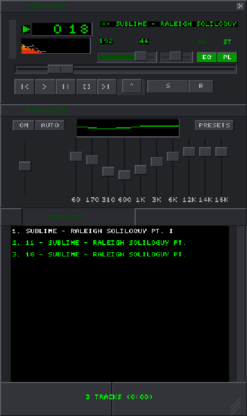

# kilix-amp - Winamp Clone for Linux, in C

A pixel-faithful recreation of the classic Winamp 2.x music player, written
in C11 with SDL2. This is a full rewrite of the Python/Qt "nixamp" project
with the same feature set and window-for-window architecture.

Installable on demand from the Kilix content catalog as `kilix-amp`
(`kilix install kilix-amp`). `kilix amp` installs the pinned build on first use
and starts the player; `kilix amp --headless` starts only its playback service.
The catalog builds with `make all runtime-check ENCODEC=1` and runs the player
as an X application in a Kilix pane.



## Features

- **Classic Winamp 2.x UI** - Bitmap-based skin rendering with all the classic elements
- **4-window layout** - Main player, Equalizer, Playlist, and waveform Editor
- **Skin support** - Load .wsz skin files or skin directories (in-house ZIP reader)
- **10-band EQ** - In-house biquad filter chain with presets (Rock, Pop, Classical, ...)
- **Spectrum analyzer** - 75-bar display with peak dots, oscilloscope mode (in-house FFT)
- **Playlist** - M3U/PLS support, drag-and-drop, shuffle, repeat, sorting
- **Editor** - waveform view with 16 effects + 5 generators, selection, undo/redo
- **Window docking** - Snap windows together like the original
- **Keyboard shortcuts** - Z/X/C/V/B transport, all Winamp defaults
- **UI scaling** - integer 1x-4x scaling for HiDPI displays
- **Headless mode** - `--headless` serves a control socket, so a text front end
  drives the same decoder instead of reimplementing playback

## Quick start

```bash
./install-deps.sh        # or the apt line in docs/build-and-playback.md
make                     # ./kilix-amp and libkilix-meter.so
make test
./kilix-amp ~/Music/
```

General playback needs the `kilix-mpv` executable on the system (or
`KILIX_MPV`); `make runtime-check` verifies the installed mpv's decoder and
filters without an audio device. `make install PREFIX="$HOME/.local"` installs
the player, the meter library and their licence files. EnCodec `.kenc`
playback is optional and built with `make ENCODEC=1`; see
[docs/encodec.md](docs/encodec.md).

## Usage

```bash
./kilix-amp                          # empty player
./kilix-amp track1.mp3 track2.flac   # play files
./kilix-amp /path/to/music/          # play a directory
./kilix-amp --skin path/to/skin.wsz  # custom skin
./kilix-amp --scale 3                # UI scale 1-4 (--double-size = --scale 2)
```

The UI scale can also be changed at runtime from the right-click menu
(SIZE section) or by pressing `D` (cycles 1x-4x); it persists across runs.

On first start a default skin is generated at
`${XDG_DATA_HOME:-~/.local/share}/kilix-amp/skins/default`. Settings are saved
to `${XDG_CONFIG_HOME:-~/.config}/kilix-amp/kilix-amp.ini` (the same INI
layout as nixamp's config). This lets desktop hosts give Kilix-Amp isolated,
persistent storage without changing `HOME`.

## Keyboard Shortcuts

| Key | Action |
|-----|--------|
| Z | Previous track |
| X | Play |
| C | Pause |
| V | Stop |
| B | Next track |
| L | Open file |
| Left/Right | Seek -/+5 seconds |
| Up/Down | Volume up/down |
| S | Toggle shuffle |
| R | Toggle repeat |
| D | Cycle UI scale (1x-4x) |
| Alt+G | Toggle equalizer |
| Alt+E | Toggle playlist |
| Alt+D | Toggle editor |
| Ctrl+Z/Y/A | Editor: undo / redo / select all |

## How it works

```
 GUI (SDL2 skins)  ----+                       +--> kilix-mpv (JSON IPC) --> libkilix-meter.so --> spectrum
 kilix-music (TUI) ----+--> Amp service ------+
 any client -----------+   (protocol-2 socket) +--> native EnCodec worker (optional, .kenc / live)
```

One per-user Amp service owns the playlist, position, volume, balance,
ten-band EQ and repeat/shuffle state; the windowed player and `kilix-music`
(in kilix-tui-utils) are both clients of it, so opening or closing a
controller does not stop playback. General media plays through a managed
`kilix-mpv` process over its private JSON IPC, with MIDI rendered by a
FluidSynth worker first; the `libkilix-meter.so` filter passes audio unchanged
and feeds the spectrum analyzer from the real output. `.kenc` files and live
EnCodec streams use an optional native decoder in a separate worker process,
and only for models admitted by the Kilix content catalog with a kilix-license
receipt; Amp never downloads a model.

The skin renderer, ZIP reader, FFT, biquad EQ, editor effects, menus and font
are in-house C. Details: [docs/build-and-playback.md](docs/build-and-playback.md),
[docs/headless.md](docs/headless.md), [docs/architecture.md](docs/architecture.md).

## Documentation

- [docs/build-and-playback.md](docs/build-and-playback.md): dependencies, the
  mpv playback path, the shared service, building and tests.
- [docs/headless.md](docs/headless.md): `--headless`, the socket path and the
  control commands.
- [docs/encodec.md](docs/encodec.md): EnCodec file and live playback, model
  admission and integration checks.
- [docs/architecture.md](docs/architecture.md): source modules and the
  differences from the Python original.
- [CONTROL-PROTOCOL.md](CONTROL-PROTOCOL.md): protocol versions 1 and 2.
- [LIVE-FORMAT.md](LIVE-FORMAT.md): the framed live EnCodec input.
- [samples/README.md](samples/README.md): the generated CC0 sample.
- [THIRD-PARTY-NOTICES.md](THIRD-PARTY-NOTICES.md): vendored Termixer, the
  screenshot, the sample and linked libraries.

## Related repositories

- [kilix-mpv](https://github.com/itsmygithubacct/kilix-mpv#readme): the
  player process behind general playback.
- [kilix-encodec](https://github.com/itsmygithubacct/kilix-encodec#readme):
  the optional native `.kenc` decoder library.
- [kilix-license](https://github.com/itsmygithubacct/kilix-license#readme) and
  [kilix-content](https://github.com/itsmygithubacct/kilix-content#readme):
  model receipts, model assets and this application's catalog entry.
- [kilix-tui-utils](https://github.com/itsmygithubacct/kilix-tui-utils#readme):
  `kilix-music`, the text front end of the same service.
- [kilix](https://github.com/itsmygithubacct/kilix#readme): the `kilix amp`
  verb.

## Part of Plebian-OS

Kilix Amp is one of the repositories behind
[Plebian-OS](https://github.com/itsmygithubacct/plebian-os#readme), a Debian
install whose desktop is [Kilix](https://github.com/itsmygithubacct/kilix#readme)
running the [Kilix 95](https://github.com/itsmygithubacct/kilix-95#readme)
desktop through [Pleb](https://github.com/itsmygithubacct/pleb#readme).
It is installed on demand from the Kilix content catalog, not shipped in the
installer image. The map of every repository and how it ships is on the
[components page](https://github.com/itsmygithubacct/plebian-os/blob/main/docs/components.md).

## Licence and notices

Kilix Amp is licensed under the MIT License; see [`LICENSE`](LICENSE).
Vendored Termixer, the project screenshot, the generated CC0 sample and linked
system libraries are dispositioned in
[`THIRD-PARTY-NOTICES.md`](THIRD-PARTY-NOTICES.md).
